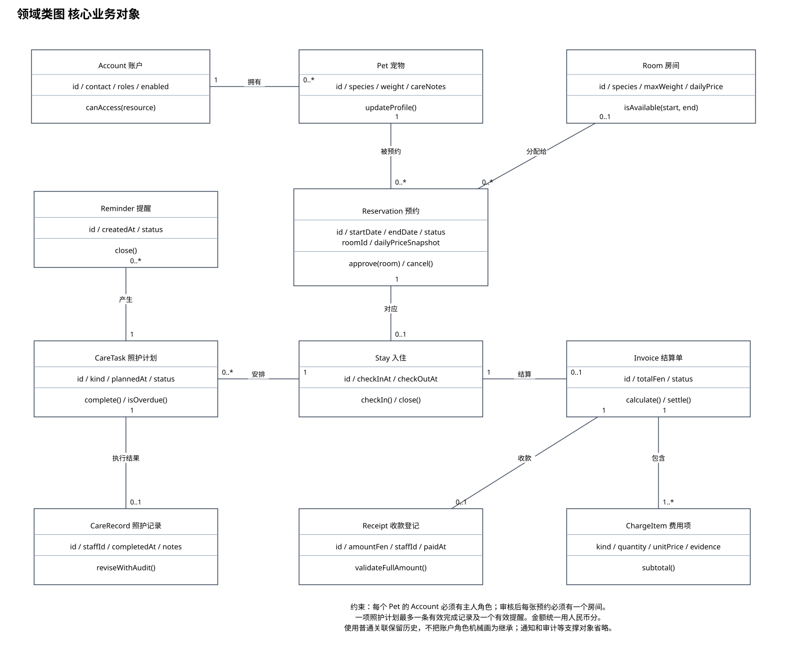

# 实验三 AI辅助的类图设计

课程：软件需求工程

选题：宠物寄养预约与照护管理系统

班级：________　组号：________　姓名与学号：________

实验日期：________　实际分工：________

本稿提供项目分析与图的说明。实验工具、AI交互、人工对比和实际操作结论需由小组完成后填写。

## 实验目标

识别领域对象、属性、操作和关系，使用多重性约束描述业务数据之间的联系。

## 类的识别

核心对象包括Account、Pet、Room、Reservation、Stay、CareTask、CareRecord、Reminder、Invoice、ChargeItem和Receipt。预约表达计划安排，入住表达实际寄养，两者分开可以准确记录取消未入住、检查失败以及实际离店时间。

## 主要关系解释

一个主人账户可拥有零至多只宠物，每只宠物只属于一个主人。每张预约关联一只宠物，待审核时可以尚未分配房间，因此预约到房间的多重性为0..1；审核通过后用额外约束要求恰好一个房间。同一房间可以在不重叠区间关联多个预约。

每张预约至多产生一次入住，一次入住可有多个照护任务。一个任务至多有一条有效完成记录，可有多条历史提醒，但至多一个有效提醒。一次入住至多有一张有效结算单，一张结算单包含一个或多个费用项，并至多对应一条有效全额收款记录。

## 关系类型选择

类之间采用普通关联，避免把业务记录的归属误解为删除时必须级联销毁的组合。角色通过Account的角色集合授权，不使用主人、工作人员、管理员的强制继承。执行人员通过staffId引用Account，图中省略该类支撑关联以保持核心业务可读性，数据字典保留字段说明。

## 属性与操作说明

Reservation保留计划日期、状态与确认后的价格快照；Room当前价格变更不影响既有订单。Invoice负责计算账单，Receipt记录线下收款登记。图中的操作属于领域职责，不指定数据库接口或技术框架。

## AI对比与人工核验建议

核验重点是预约和入住是否混为一类、房间数量限制能否表达、类图多重性是否与业务一致，以及是否误把角色关系画成继承。可对AI提出反例：两个工作人员同时确认同一房间怎么办，宠物未入住就取消是否仍需要入住记录。实际对比材料需按记录模板补充。

## 结论与待完善事项

领域模型覆盖业务主线，通知、审计、维护区间与授权明细属于后续逻辑设计中的支撑对象。图不作为完整数据库表结构或已实现代码的证明。
