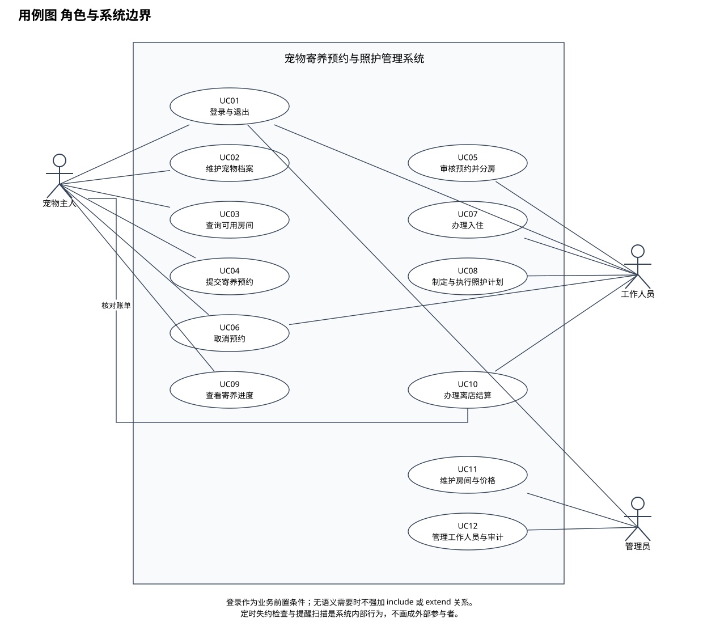

# 实验二 AI辅助的用例图绘制

课程：软件需求工程

选题：宠物寄养预约与照护管理系统

班级：________　组号：________　姓名与学号：________

实验日期：________　实际分工：________

本稿提供项目分析与图的说明。实验工具、AI交互、人工对比和实际操作结论需由小组完成后填写。

## 实验目标

从项目需求中识别系统外部参与者及其目标，明确系统边界，形成用例图和详细用例说明。

## 参与者识别

宠物主人负责申请与查看本人寄养业务；工作人员处理审核、入住、照护和结算；管理员管理房间、价格及工作人员授权。三者是权限角色，同一个账户可以拥有多个角色，因此本图不画角色继承。

## 用例与关系分析

UC01至UC12分别覆盖登录、宠物档案、房间查询、提交预约、审核分房、取消、入住、照护、查看进度、结算和基础管理。主人参与结算的账单核对，工作人员执行收款登记与结单。

本图采用参与者与用例之间的普通关联。登录属于受保护业务的前置条件，不将所有用例都画成包含登录。当前粒度没有必须抽取的公共子用例，也没有必须建模的扩展用例，因此不为展示符号而添加 include 或 extend。

## 典型用例说明

UC05审核分房以待审核预约为前置条件。工作人员选择具体房间后，系统重新检查物种、体重和日期冲突；无冲突时保存价格快照并确认预约；有冲突时保持待审核。UC07入住还必须检查实际占用，避免计划区间未冲突但前一只宠物逾期未离店的情况。

## AI辅助与人工核验建议

可用提示词为：从需求说明书识别外部参与者和用户目标，说明哪些动作是前置条件，检查是否误用包含和扩展。人工需核对主人是否只能访问本人资源、定时任务是否被误画为参与者，以及结算是否遗漏主人的核对角色。实际使用的提示词、AI原始输出和人工修改请填写记录模板。

## 结论与待完善事项

用例图覆盖主要外部目标，详细步骤在UC01至UC12中展开。提交前需按教师要求在Visio中绘制或确认可接受现有格式，并填写本组实际绘图、核验和修改记录。
