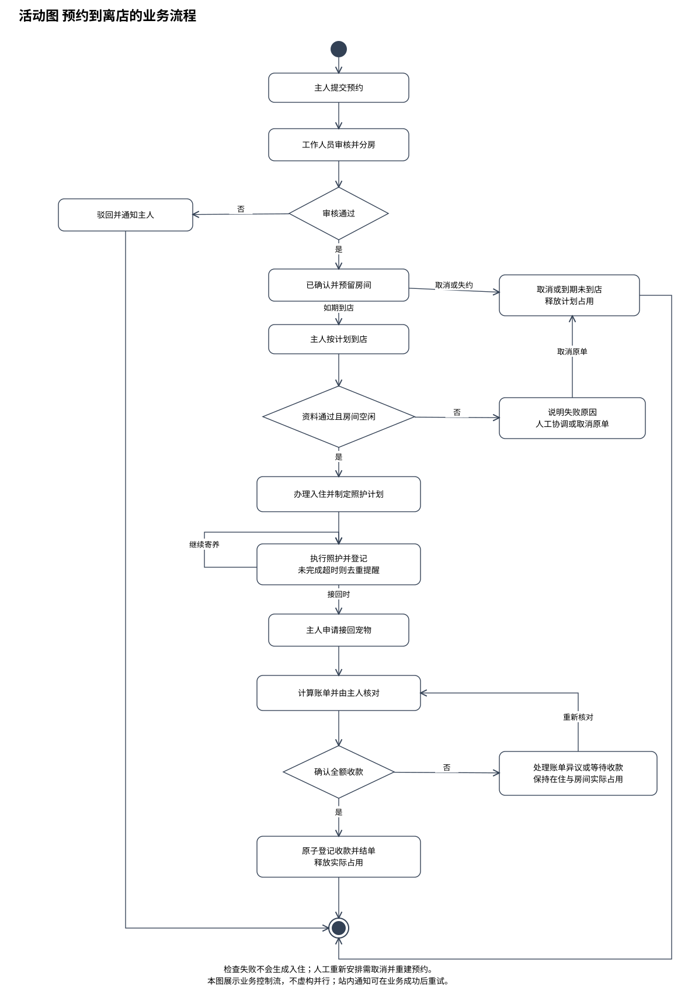

# 实验五 AI辅助的活动图绘制

课程：软件需求工程

选题：宠物寄养预约与照护管理系统

班级：________　组号：________　姓名与学号：________

实验日期：________　实际分工：________

本稿提供项目分析与图的说明。实验工具、AI交互、人工对比和实际操作结论需由小组完成后填写。

## 实验目标

对预约、入住、照护和结算的业务活动进行建模，展示分支、循环和终止条件。

## 主流程说明

主人提交预约，工作人员审核并分配房间。审核通过后预约获得计划占用；主人按计划到店，工作人员检查资料和房间实际空闲状态，通过后办理入住并制定照护计划。在住期间重复执行照护和登记；主人申请接回后生成账单，核对并全额收款后结单。

## 分支与终止

审核失败进入驳回后终止。本单在入住前取消或到期未到店时释放计划占用并终止。入住检查失败不创建入住，进入人工协调，需要重新安排时取消原单后重新申请；新申请属于新的流程实例。

结算存在异议或未确认全额收款时，返回费用核对与等待，预约继续保持已入住，房间也保持实际占用。确认收款并成功结单才释放实际占用。

## 循环与提醒

照护活动在宠物继续寄养期间循环。内部扫描每五分钟检查照护任务，超过计划时间30分钟仍未完成则创建去重提醒；任务完成关闭提醒。活动图对照护过程作摘要，具体时间规则以需求说明书为准。

## 并行判断

本业务主流程不要求强制并行。不能为了展示同步条而将“收款”和“关闭入住”画成互不依赖的并行活动。通知发送可由业务成功后的内部处理重试，但不影响主流程是否成功。

## AI流程核验建议

核对每个判断的条件是否完整、循环是否有退出条件、所有终止分支是否释放了正确的计划或实际占用，以及结算失败是否错误释放房间。用取消、逾期占房、未全额收款三个反例走查流程，并记录实际发现的问题和修订。

## 结论与待完善事项

活动图表达业务控制流，顺序图表达对象协作，两者在审核、入住和结单的状态结果上保持一致。待补充实际小组讨论记录和最终绘图截图。
