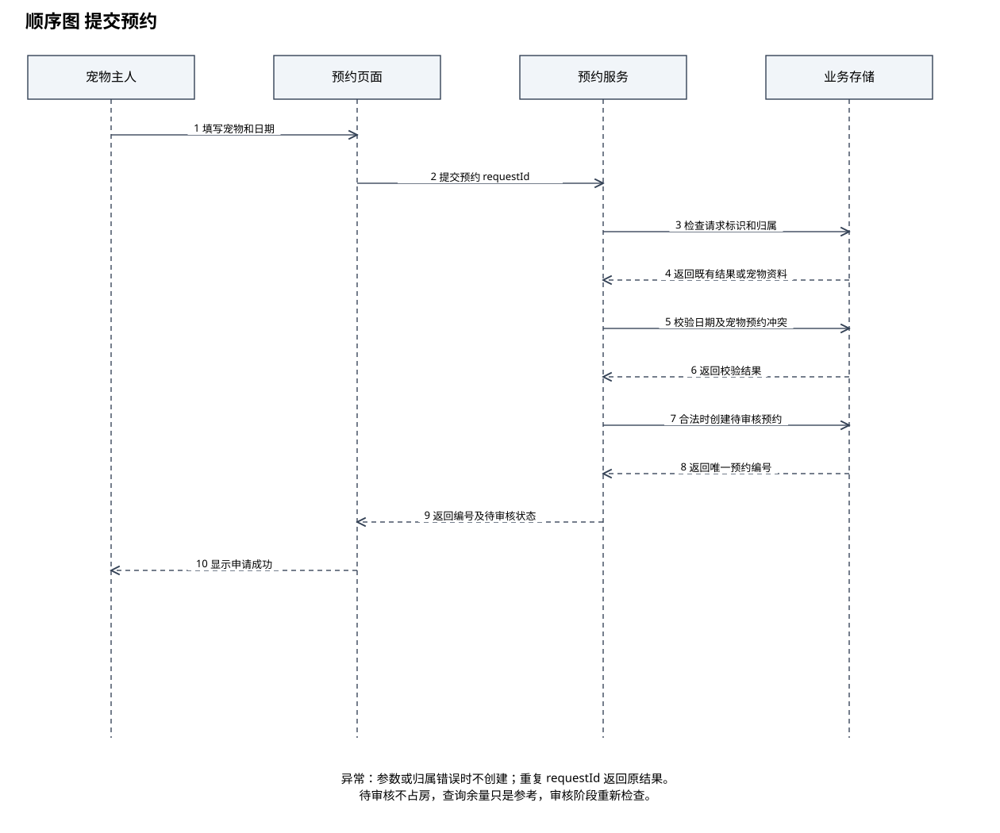
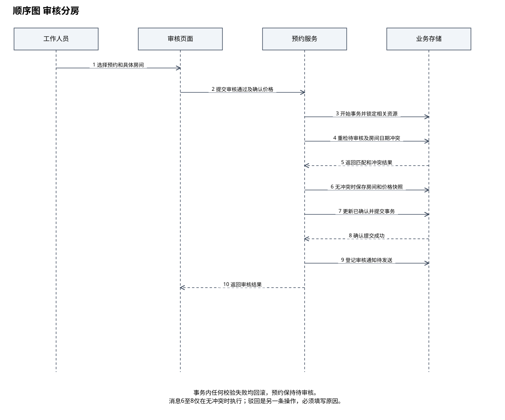
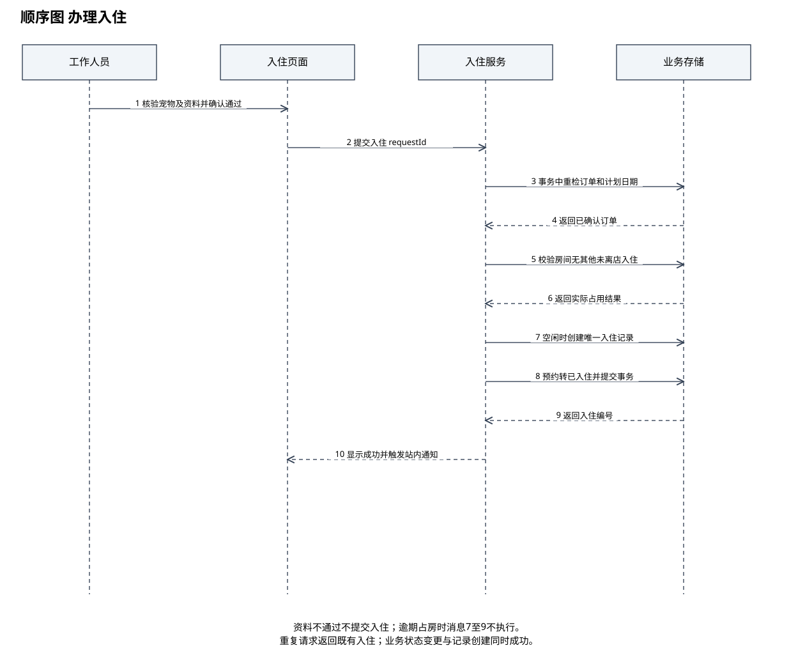
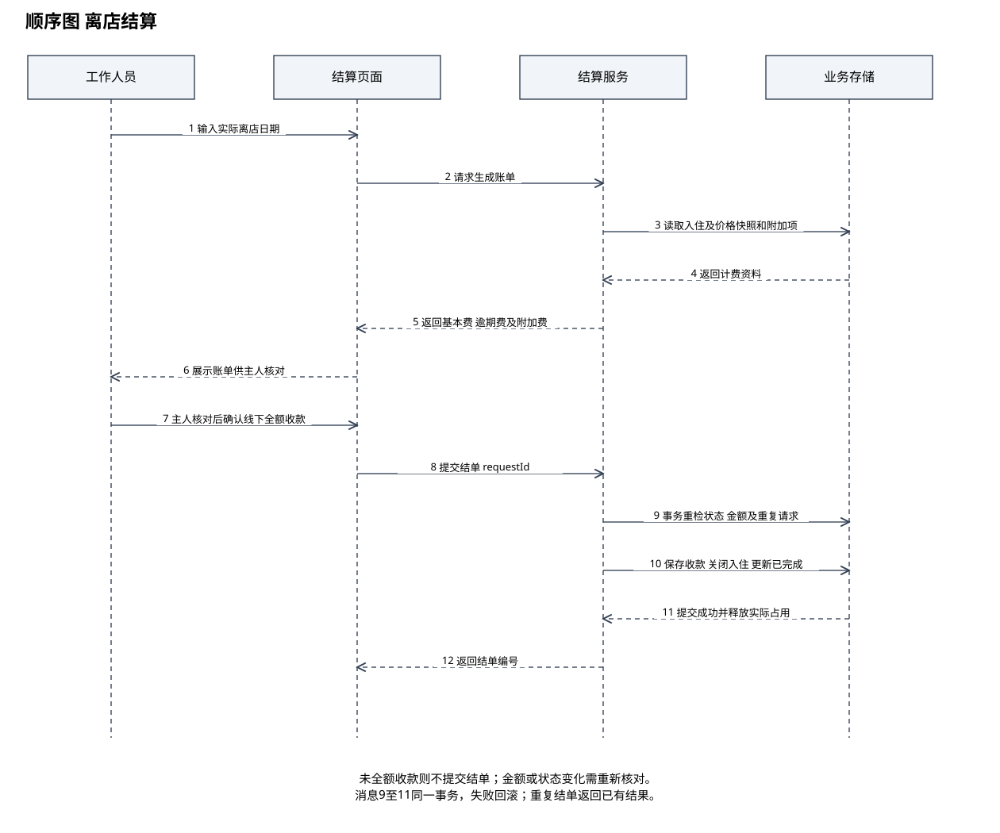

# 实验四 AI辅助的顺序图绘制

课程：软件需求工程

选题：宠物寄养预约与照护管理系统

班级：________　组号：________　姓名与学号：________

实验日期：________　实际分工：________

本稿提供项目分析与图的说明。实验工具、AI交互、人工对比和实际操作结论需由小组完成后填写。

## 实验目标

将典型用例转为按时间排序的对象消息，明确页面、业务服务和存储之间的职责及失败处理。

## 生命线划分

四个场景均采用外部操作者、页面、业务服务、业务存储的四条生命线。页面负责收集信息和显示结果，服务负责业务校验与状态变更，存储负责持久化和并发约束。图中业务存储是技术协作对象，不属于领域类图中的实体类。

## 场景一 提交预约

主人填写日期和宠物后，页面发送带唯一请求标识的申请。服务检查请求重复、档案归属、日期合法性与宠物重叠预约，合法时创建待审核预约。待审核不分配房间，也不预留库存；重复请求返回原编号。

## 场景二 审核分房

工作人员选择具体房间和确认价格后，服务在事务中重检预约仍为待审核、房间匹配且日期无冲突，然后保存分房和价格快照，更新已确认。并发冲突或状态变化时回滚；只有业务成功后才安排通知，通知失败不撤销已确认结果。

## 场景三 办理入住

工作人员先核验宠物与资料，再提交入住。服务重检已确认状态、当天为计划开始日和房间实际空闲；全部通过后，同时创建入住记录和更新预约。逾期宠物仍在房间时拒绝入住，提示人工协调，不凭计划日期直接放行。

## 场景四 离店结算

服务依据价格快照、计划天数、逾期天数和已确认附加项目计算账单。主人核对后，工作人员登记全额线下收款。服务再次校验金额与状态，在同一事务保存收款、结束入住、更新预约为已完成。事务失败回滚，重复结单返回已有结果。

## 异常与表示约定

PlantUML源文件包含alt条件片段；SVG与draw.io版以条件文字和图下注释说明条件消息，按主成功路径排列。若教师要求标准组合片段边框，请在Visio中以PlantUML的alt分支重绘。四张图均用虚线表达返回，实线表达请求，不将返回箭头误当成新业务操作。

## 需求变更练习

可提出“收款确认前增加价格二次核对”的变更。此时需在结单事务前重新读取费用项，金额变化返回核对页面，而不能沿用旧账单直接结单。记录原需求、变更原因、修改消息及关联验收场景；本包已经采用结单前重检金额的设计，不将该练习描述为已经开展的实验。

## 结论与待完善事项

顺序图聚焦关键状态变更和事务边界，实际实验中的AI原始结果、人工修订和截图由小组补充。

## 配套顺序图

